<p align="center">
  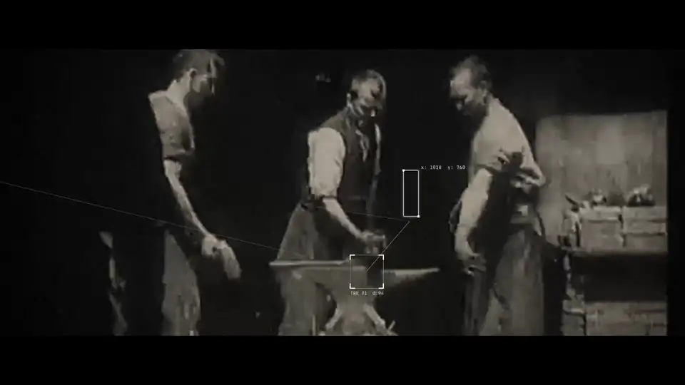
</p>

<h1 align="center">kinetograph.</h1>

<p align="center"><b>A blazingly fast programmatic video engine, made for agents.</b></p>

<p align="center">
  <a href="#rendered-with-kinetograph">Examples</a> ·
  <a href="#projects-in-tsx">Get started</a> ·
  <a href="packages/cli/skills/kinetograph/references/ENGINE.md">The engine</a> ·
  <a href="packages/site/content/docs/guides/agents.mdx">Use with agents</a>
</p>

You (or an agent) write a video in TypeScript with Remotion's API, CSS, SVG, Canvas 2D, WebGL shaders and Web Audio;
Node runs the code; a Rust GPU compositor, loaded into Node as an N-API addon, draws every frame. Existing Remotion
projects render as they are: `remotion` and `@remotion/*` imports resolve to Kinetograph's own implementation of them.

**The film above is 1,184 frames of 1080p video, sound included, rendered in 26 seconds on a laptop.** It is one
TypeScript project in [`examples/launch`](examples/launch).

<details>
<summary>Credits for the film's footage</summary>

- "Blacksmith Scene" (Edison, 1893) and "Fred Ott's Sneeze" (Edison, 1894), public domain.
- "Armistice Day Parade, Columbus, Ohio, 1927", US National Archives
  ([archive.org/details/111-h-1555](https://archive.org/details/111-h-1555)), a US government work.
- SMPTE Universal Leader, public domain.
- The handwritten "FILM" and the 16mm film burn are from licensed overlay packs ("Text Animation Overlays" and
  "Custom Transitions: Film Burns"); they are not in the repo.

</details>

## Rendered with Kinetograph

Each clip is an example in this repo. Times are `kinetograph render --concurrency 4` on an Apple M4, the median of
three runs.

<table>
  <tr>
    <td width="50%">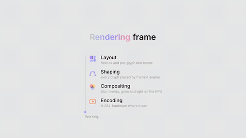<br><b>Showcase</b><br><sub>928 frames · 1920×1080 · 37 s of video · <b>rendered in 13 s</b></sub></td>
    <td width="50%">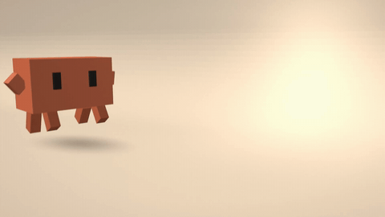<br><b>3D scenes</b><br><sub>180 frames · 1920×1080 · 6 s of video · <b>rendered in 2.3 s</b></sub></td>
  </tr>
  <tr>
    <td>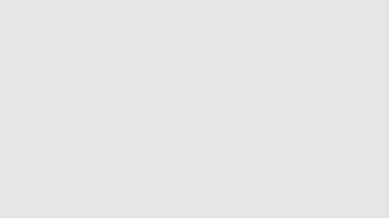<br><b>Rajz cards</b><br><sub>125 frames · 1920×1080 · 5 s of video · <b>rendered in 5.1 s</b></sub></td>
    <td>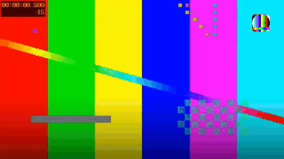<br><b>Video overlay</b><br><sub>180 frames · 1920×1080 · 6 s of video · <b>rendered in 1.9 s</b></sub></td>
  </tr>
  <tr>
    <td>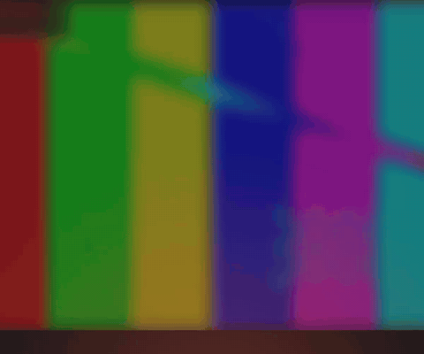<br><b>Remotion compat test</b><br><sub>150 frames · 1200×1000 · 5 s of video · <b>rendered in 2.3 s</b></sub></td>
    <td>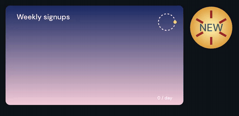<br><b>Canvas 2D</b><br><sub>60 frames · 860×420 · 2 s of video · <b>rendered in 0.6 s</b></sub></td>
  </tr>
  <tr>
    <td>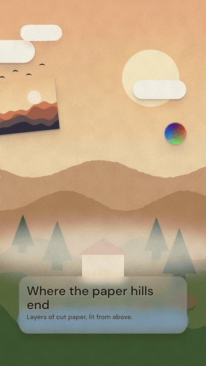<br><b>Diorama scene (JSON)</b><br><sub>90 frames · 1080×1920 · 3 s of video · <b>rendered in 2.2 s</b></sub></td>
    <td>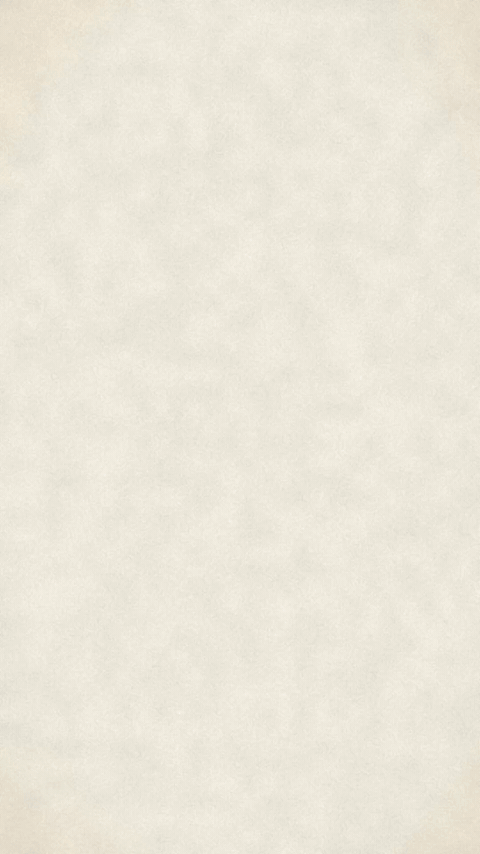<br><b>Papercut card (JSON)</b><br><sub>60 frames · 1080×1920 · 2 s of video · <b>rendered in 0.7 s</b></sub></td>
  </tr>
</table>

### Papercut explainers

Three episodes of *Tape & Code*, the papercut explainer series of the Tiny Agent channel, written for Remotion and
rendered by Kinetograph as they are. Same machine and settings as above.

<table>
  <tr>
    <td width="33%">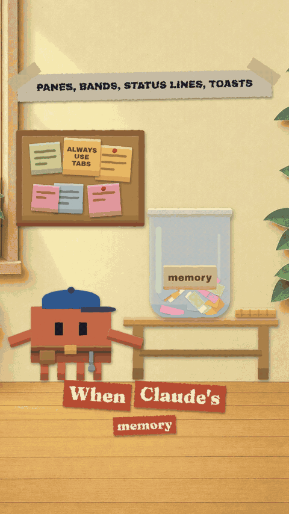<br><b>Ep. 13: Mods</b><br><sub>988 frames · 1080×1920 · 33 s of video<br><b>rendered in 23 s</b></sub></td>
    <td width="33%">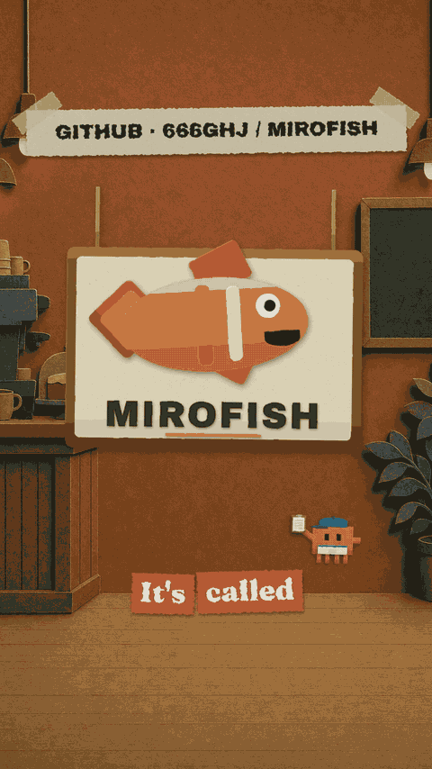<br><b>Ep. 12: Mirofish</b><br><sub>879 frames · 1080×1920 · 29 s of video<br><b>rendered in 32 s</b></sub></td>
    <td width="33%">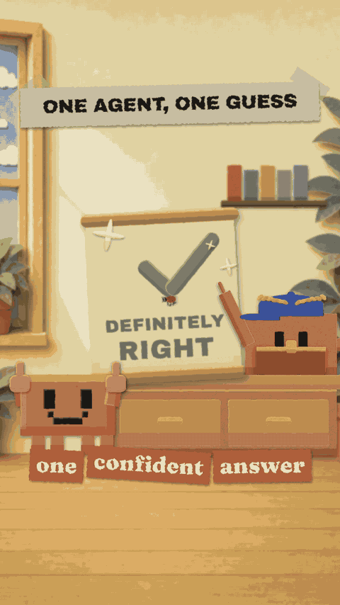<br><b>Ep. 10: The War Skill</b><br><sub>850 frames · 1080×1920 · 28 s of video<br><b>rendered in 75 s</b></sub></td>
  </tr>
</table>

## Status

**Beta, version 0.1.0.** It works and renders real projects, but APIs can still change between versions and some
features are missing. The core renderer, effects, authoring layer, studio, Remotion compatibility on a native DOM
engine (CSS, SVG, Canvas 2D, WebGL fragment shaders) and an own 3D layer are built. The papercut test project renders
all 988 of its frames natively. What is left is listed under known issues on the kinetograph site
(`/docs/known-issues/`).

- [The DOM engine](packages/cli/skills/kinetograph/references/ENGINE.md), and Remotion compatibility on the kinetograph site (`/docs/compat/`)
- [Authoring contract](packages/cli/skills/kinetograph/references/AUTHORING.md): the TS packages, the addon's API and how elements map to scenes
- [Scene format](packages/cli/skills/kinetograph/references/SCENE.md)
- [Changelog](CHANGELOG.md): what changed since 0.1.0. On `main` now: GSAP with its free plugins (a paused timeline
  seeked per frame), `<Video datamosh>` ([guide](packages/site/content/docs/guides/datamosh.mdx)), and a "Copy for
  agent" button in the studio.

## Architecture

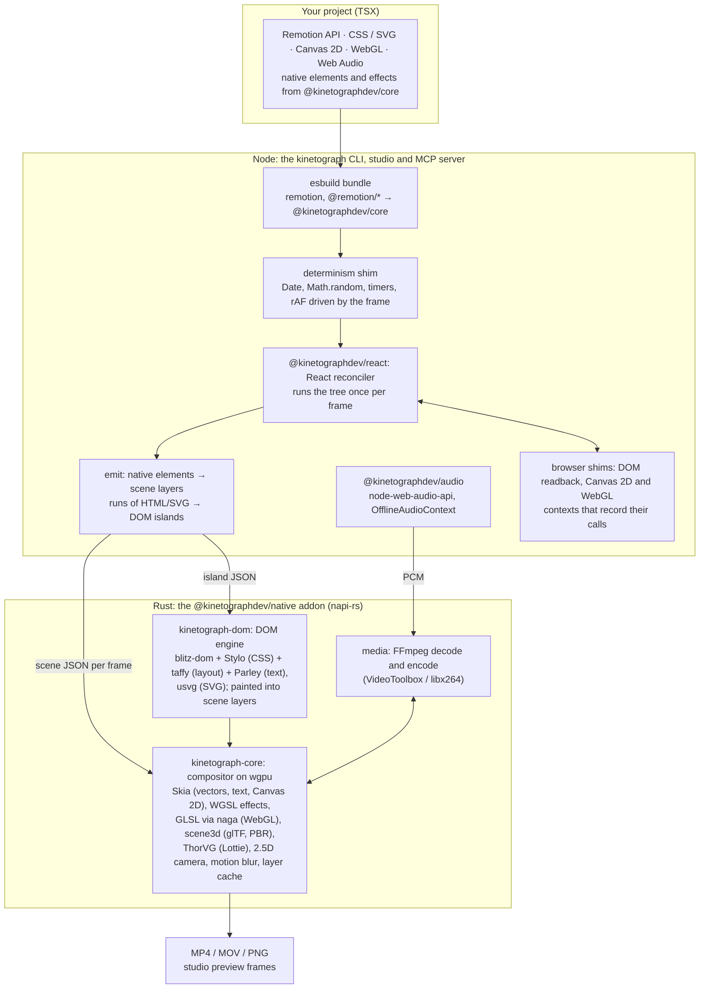

No Chrome anywhere in rendering, including canvas and WebGL: every CSS, SVG and canvas feature
is ported natively, and Chrome for Testing is used only by tests, as a reference to compare against. Node hosts the
engine so every npm package and Web API is there; the engine is a native addon so pixels never cross into JavaScript.
Existing crates do text shaping, layout, CSS and rasterising; Kinetograph writes the glue.

## Projects in TSX

Node 22 or later. The npm workspaces are `@kinetographdev/scene` (scene types and effect helpers), `@kinetographdev/react`
(the reconciler and native elements), `@kinetographdev/core` (Remotion's API and packages, the frame loop, the
determinism shim), `@kinetographdev/audio`, the `kinetograph` CLI, and `@kinetographdev/native` (the addon, `crates/node`).

```sh
npm ci
npm run build                                   # TS packages and a debug addon
npm run build:release -w @kinetographdev/native    # the addon for timing

npx kinetograph still examples/rajz-cards/index.tsx 60 -o out/rajz-60.png
npx kinetograph strip examples/rajz-cards/index.tsx -n 12 -o out/rajz-strip.png
npx kinetograph render examples/rajz-cards/index.tsx -o out/rajz-cards.mp4
npx kinetograph inspect examples/rajz-cards/index.tsx --frame 60 --json
```

A project imports from `remotion` and `@remotion/*` as it would for Remotion (the CLI maps them onto
`@kinetographdev/core`) and from `@kinetographdev/core` for the native elements and effects. Every command takes `--json`;
`npx kinetograph mcp` serves the same commands over MCP; [Use with agents](packages/site/content/docs/guides/agents.mdx)
has the client setup and the agent skill. `npm test` runs the CPU tests; the GPU ones run with
`KINETOGRAPH_GPU_TESTS=1`.

## Build from source

Use the rustup toolchain (stable, edition 2024) and a GPU that wgpu supports (Metal on macOS); no display is needed.
`render` links FFmpeg, so building needs its development libraries (`brew install ffmpeg` on macOS).

```sh
cargo build --release
./target/release/kinetograph render examples/papercut-card.json -o out/card.mp4
```

How a frame is made, the code map, the Rust CLI, the layer cache and frame reuse are in
[packages/cli/skills/kinetograph/references/INTERNALS.md](packages/cli/skills/kinetograph/references/INTERNALS.md).

## License

[PolyForm Small Business License 1.0.0](LICENSE.md): free for individuals, non-profits, and companies with fewer than
100 people and under 1,000,000 USD (2019) revenue. Larger companies need a commercial licence; see
[COMMERCIAL.md](COMMERCIAL.md). Vendored crates keep their own licences ([vendor/README.md](vendor/README.md)).

Required Notice: Copyright 2026 Sanat Gupta (https://github.com/0xS4N4TG)
