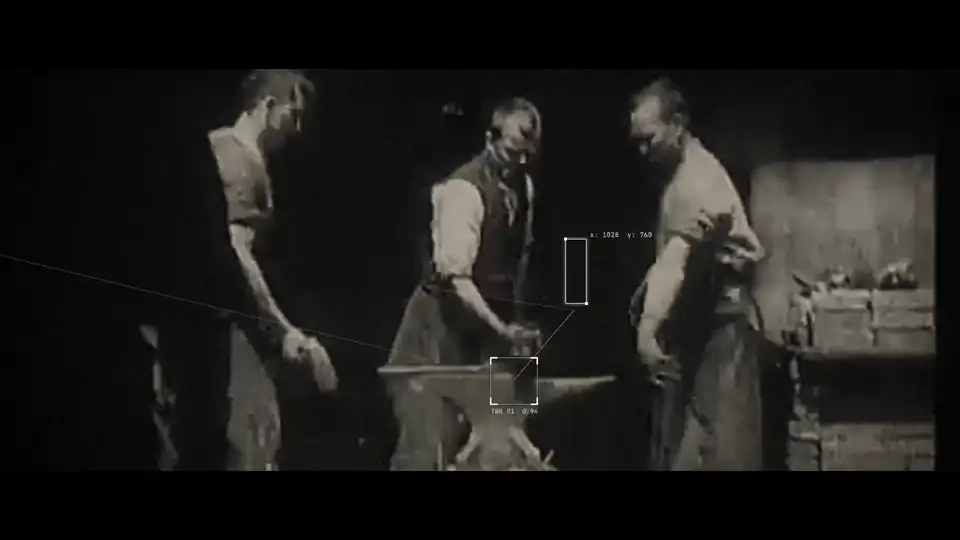
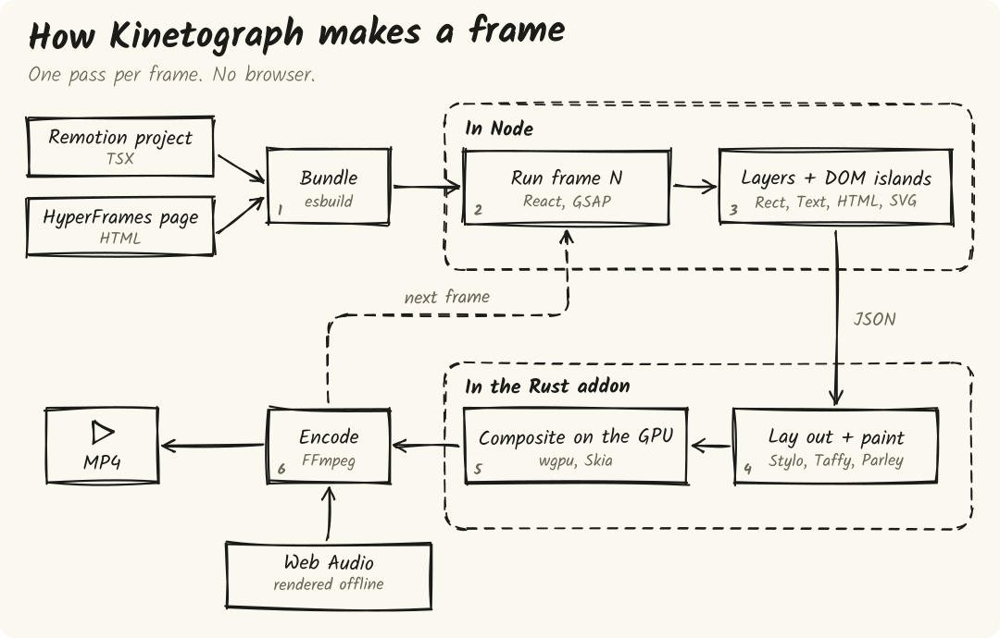

<p align="center">
  
</p>

<h1 align="center">kinetograph.</h1>

<p align="center"><b>A blazingly fast programmatic video engine, made for agents.</b></p>

<p align="center">
  <a href="https://github.com/0xS4N4TG/kinetograph/stargazers"></a>
  <a href="https://www.npmjs.com/package/kinetograph"></a>
  <a href="https://www.npmjs.com/package/kinetograph"></a>
  <a href="https://github.com/0xS4N4TG/kinetograph/actions/workflows/native.yml"></a>
  <a href="https://kinetograph.dev/docs/"></a>
</p>

Kinetograph makes videos from code, without a browser. You (or an agent) write a video in TypeScript with Remotion's
API, or as a plain HTML page. Node runs the code, and a Rust GPU compositor draws every frame: CSS, SVG, Canvas 2D,
WebGL shaders, 3D and Web Audio. Existing Remotion projects render as they are, and so do
[HyperFrames](https://github.com/heygen-com/hyperframes) projects. The film above is one TypeScript project in
[`examples/launch`](examples/launch).

Kinetograph is in beta (version 0.3.0). APIs can still change between versions.

## Install

You need Node.js 22 or newer. The prebuilt package covers macOS on Apple Silicon, Linux x64 and Windows x64, and
installs in about a minute with nothing else to set up:

```sh
npm install kinetograph
npx kinetograph doctor
```

Building from source is only for working on the engine, or for a platform with no prebuilt package. It needs Rust and
the FFmpeg libraries and takes 15 to 30 minutes: see
[Installation: From source](https://kinetograph.dev/docs/getting-started/installation/#from-source).

### Install with a coding agent

Paste this into Claude Code, Codex or another coding agent:

```text
Set up Kinetograph (https://github.com/0xS4N4TG/kinetograph) for me by following its AGENTS.md:
https://github.com/0xS4N4TG/kinetograph/blob/main/AGENTS.md
Ask me first whether I want the prebuilt package (recommended) or a build from source,
and ask before installing anything system-wide or installing the Kinetograph agent skills.
```

## Make a video

Start a project in an empty folder:

```sh
npx kinetograph init          # TSX, Remotion-style
npx kinetograph init --html   # or an HTML / HyperFrames page
npm install
```

`init` makes `src/` for code (or `html/` for a page), `public/` for images, fonts, audio and video, and `out/` for
everything Kinetograph writes. It also writes a starter title card. Render it:

```sh
npx kinetograph render src/index.tsx      # writes out/renders/Main.mp4
npx kinetograph render html/index.html    # for an HTML project
```

## How it works

<picture>
  <source media="(prefers-color-scheme: dark)" srcset="docs/readme/engine-dark.svg">
  
</picture>

Node runs your project and a Rust addon draws each frame on the GPU. The [Engine](https://kinetograph.dev/docs/internals/engine/) page walks through the six steps.

## Docs

Everything else is on the docs site, [kinetograph.dev/docs](https://kinetograph.dev/docs/):

- [Installation](https://kinetograph.dev/docs/getting-started/installation/) and [First video](https://kinetograph.dev/docs/getting-started/first-video/)
- [Authoring](https://kinetograph.dev/docs/guides/authoring/) and [Remotion compatibility](https://kinetograph.dev/docs/compat/)
- [Studio](https://kinetograph.dev/docs/guides/studio/), the local editor
- [Use with agents](https://kinetograph.dev/docs/guides/agents/)
- [Engine](https://kinetograph.dev/docs/internals/engine/) and [What works](https://kinetograph.dev/docs/compat/)
- [Changelog](CHANGELOG.md) and [Contributing](https://kinetograph.dev/docs/contributing/)

<details>
<summary>Credits for the film's footage</summary>

- "Blacksmith Scene" (Edison, 1893) and "Fred Ott's Sneeze" (Edison, 1894), public domain.
- "Armistice Day Parade, Columbus, Ohio, 1927", US National Archives
  ([archive.org/details/111-h-1555](https://archive.org/details/111-h-1555)), a US government work.
- SMPTE Universal Leader, public domain.
- The handwritten "FILM" and the 16mm film burn are from licensed overlay packs ("Text Animation Overlays" and
  "Custom Transitions: Film Burns"); they are not in the repo.

</details>

## License

Kinetograph is open source under the [Apache License 2.0](LICENSE.md), free for any use, including commercial. Vendored
crates keep their own licences ([vendor/README.md](vendor/README.md)).
